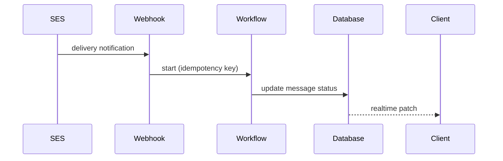

# Pull request description

- Commits: !`git log --oneline origin/HEAD..HEAD 2>/dev/null || git log --oneline -15 2>/dev/null || true`
- Diff stat: !`git diff --stat origin/HEAD...HEAD 2>/dev/null || git diff --stat main...HEAD 2>/dev/null || git diff --stat HEAD~1 2>/dev/null || true`
- Recent titles on the default branch: !`git log --format='%s' -20 --first-parent origin/HEAD 2>/dev/null || git log --format='%s' -20 --first-parent 2>/dev/null || true`
- Template: !`cat .github/pull_request_template.md 2>/dev/null || echo "none"`

Write for one person who was not in the conversation, who can already read the diff, and who
is deciding in fifteen seconds whether they understand the change.

## Title

Follow the convention visible in the recent titles above. A squash merge turns this title
into the commit on the default branch, so it inherits that history's style:

- `fix(email-parser): keep content that follows an auto-quote`
- `feat(notifications): add archive and shared list to the dock panel`
- `refactor(extensions): move channel adapters behind one interface`

Imperative, naming the outcome, at most 72 characters. When the repository squash-merges, the
title is a commit subject and follows the `commit-message` skill's rule of under 50 characters
when possible. Drop the `type(scope):` prefix only when the recent titles show the repository
does not use one.

## Body

Open with two to five sentences of prose, no heading above them, naming the specific cause the
way you would say it out loud:

> The composer keyed the draft by ticket id but never cleared it on unmount, so switching
> tickets showed the previous ticket's draft. The draft is now keyed by ticket and channel and
> cleared when the composer closes.

When reverting the merge would not undo the change, the opening says so in bold, with what a
rollback would take instead: a migration that drops or rewrites data, a renamed public API,
event, or stored key that other code already reads, messages or webhooks already sent. A change
a revert fully undoes says nothing about rollback.

Then apply one test to everything else: **can the reviewer get this from the diff?**

Keep what they cannot: the cause, why this approach over the obvious alternative, what it
costs, the limits of the fix, scope you cut on purpose, how to check it, a screenshot or a
recording of a change a user can see, risk from a migration or a flag or a rollback, a link to the task.

When the work is for a tracker issue, the body ends with its closing keyword or its reference
per the `issue-tracker` skill. A pull request to a branch other than the default one
closes nothing on GitHub.

Cut what they can: which files changed, which functions were added, signatures, prop lists,
config keys, and any retelling of the diff. They have the Files tab.

## Layout

Prose is the default. Reach for a shape only when it beats a paragraph.

**Table.** Use one when several items share the same two or three attributes: before and
after values, per-endpoint limits, renamed things, flags and their defaults.

| Endpoint | Before | After |
| --- | --- | --- |
| `POST /attachments` | unlimited | 20 per minute per user |
| `POST /tickets` | 60 per minute | unchanged |

**Tree.** When the change moves a call or a component under a different parent, and the
pieces sit in several files, the Files tab shows each file's edit but not the new shape. A
text tree in a `diff` block shows it, with only the nodes on the changed path:

```diff
 submitForm
   createSession
     persistPrompt
+    expandSkillMention
     launchAgent
-  navigateToSession
+  navigateToSession
+    subscribeToEvents
```

**Diagram.** Only when the change alters the order of events between several actors, such as
services, processes, or a client and a server. One scenario, no database schema, no code
inside it. GitHub renders a `mermaid` fenced block in the pull request body and in comments.



**Screenshots and recordings.** When a user can see the change, show it rather than describe
it. Something new, such as a new screen, panel, or control, gets one screenshot of it. Something
that changed, such as a fix or a reworked screen, gets Before and After: two stills taken at the
same viewport, with the same data, in the same state, cropped to the part that changed, in a
two-column table. A recording is for motion, timing, or a flow of more than one step: one
scenario, under about 30 seconds, each video alone on its own line. A change nobody can see gets
no media, because a screenshot of a diff or a passing test says less than the sentence about
it. Its evidence is a command and its output, cut to the lines that carry the signal, in one
fenced block: for a fix, the command that showed the defect with its failing output before and
its passing output after, and for new behavior, the command that exercises it. A suite going
green is not that evidence.

| Before | After |
| --- | --- |
|  |  |

Alt text says what the frame shows. Reference each file by its local path, write the body to a
file, and name every file with `--attach`, which uploads it to GitHub the way a drag into the
browser does and rewrites the path in the body to the uploaded URL. The rewrite happens only
when the path in the body is written exactly as the `--attach` argument. `./before.png` in the
body with `--attach media/before.png` uploads the file, appends it to the end of the body, and
leaves `./before.png` as a broken image. So put the body and the media in one folder and run
`gh` from that folder, so both sides read `./before.png`:

```bash
cd <media folder> && gh pr create --title "<title>" --body-file body.md --attach ./before.png --attach ./after.png
```

`gh pr edit` and `gh pr comment` take the same flag. Images are png, jpg, gif, webp, or svg, up
to 10 MB. Video is mp4, mov, or webm, and renders as a player only when it stands alone on its
line. A path the body references but no `--attach` names stays a broken link. After the
command, `gh pr view <number> --json body -q .body | grep -n '](\./'` must print nothing. A line
it prints is a broken image, so fix the paths and run `gh pr edit` again with the corrected body.
When `gh pr create --help` lists no `--attach`, this `gh` is too old. Open the PR without the
media, keep the files, and say where they are.

Keep bullets to one level and bold the one thing the reviewer must not miss. No emoji headers,
no checklists you ticked yourself.
